<div align="center">

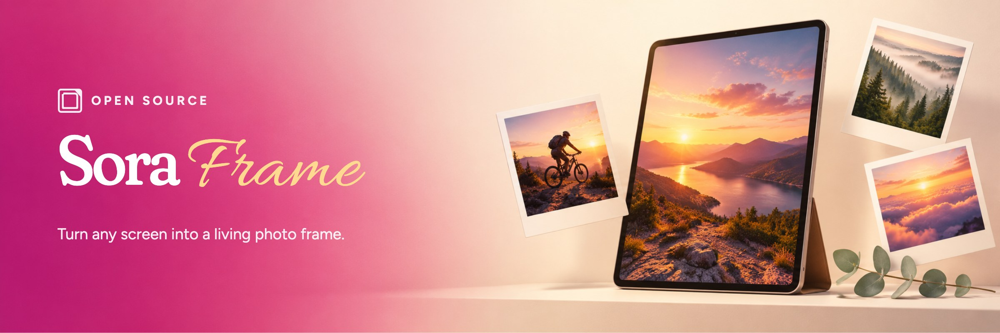

<br>

**A self-hosted digital photo frame that runs in any browser.**<br>
Put an old tablet, laptop or smart TV on the shelf and fill it with your photos.

[Website](https://sora-frame.vercel.app/) · [Quick start](https://docs-sora-frame.vercel.app/quickstart/) · [Docs](https://docs-sora-frame.vercel.app/) · [API](https://docs-sora-frame.vercel.app/api-reference/introduction)


<br>

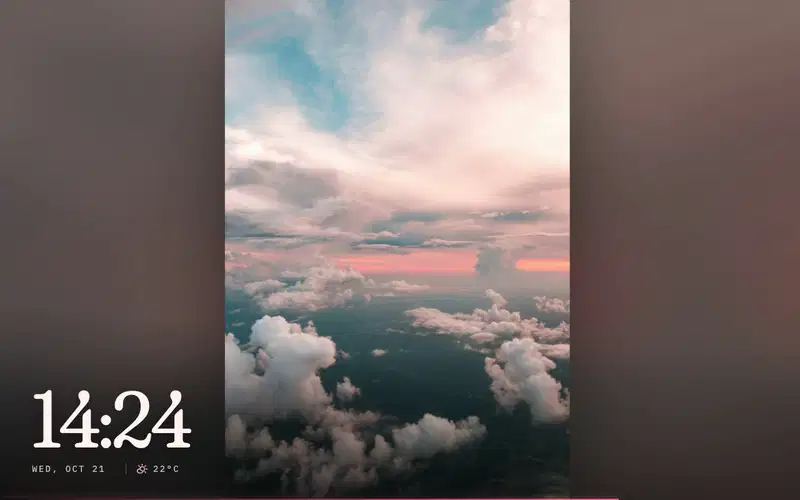

</div>

## Quick start

```bash
git clone https://github.com/Sorbh/sora-digital-photo-frame.git
cd sora-digital-photo-frame
npm install   # installs the server and creates server/.env
npm start
```

Set `ADMIN_PASSWORD` in `server/.env`, then open:

| | |
|---|---|
| **Slideshow** | `http://localhost:3000` |
| **Library** (admin) | `http://localhost:3000/admin` |

Prefer Docker? `ADMIN_PASSWORD=yourpassword docker compose up -d` — see [DOCKER.md](DOCKER.md).

## What it does

**🖼 The frame**
- Full-screen slideshow with soft cross-fades and a large clock, date and weather widget.
- Pick what plays: everything, or a single folder (nested folders included).
- Keeps the screen awake, including on iPads and phones.
- Install it to the home screen like an app.

**📁 The library**
- Upload by dropping photos anywhere on the page, or with the Upload button.
- Folders show covers from their own photos; nest them as deep as you like.
- Drag a photo onto a folder, a breadcrumb or the back button to move it.
- Select several photos and delete them in one go; right-click for more options.
- Optional Google Photos import.

**💌 Notes**
- Slip a note into the slideshow: "Ambika is visiting you", with up to four photos.
- It shows every few minutes between two dates, with an optional countdown to the event.
- Pick a memory-book layout, a theme, and which frames or PINs see it.

**🔑 Sharing**
- Give each frame or family member their own PIN.
- Limit each PIN to the folders it may show.
- Pair a frame by scanning the QR code on its screen with your phone. It stays signed in, and you can unpair it from Access.
- Frames with no keyboard can sign in from the address: `http://<server>:3000/slideshow?pin=123456`.

## A closer look

<table>
  <tr>
    <td width="50%">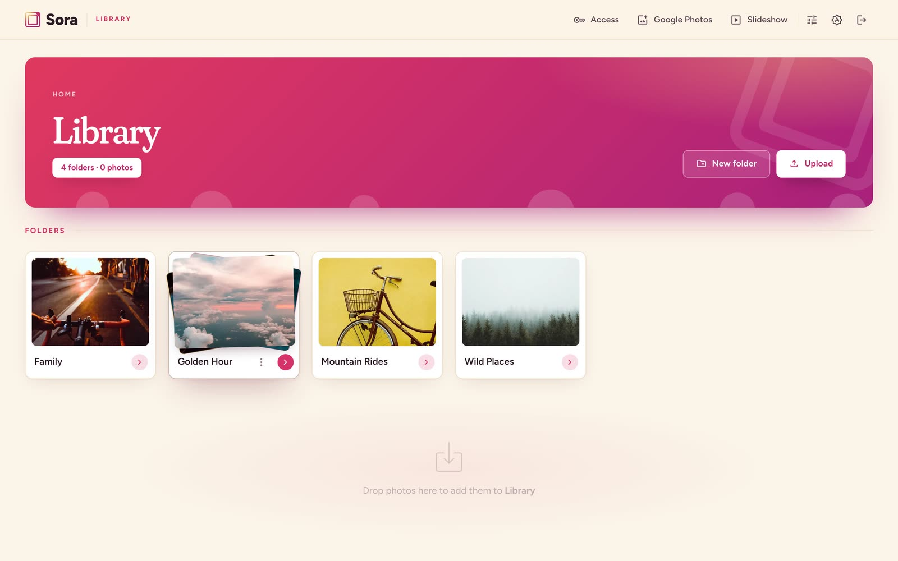<br><sub><b>Library</b> — folders with photo covers</sub></td>
    <td width="50%">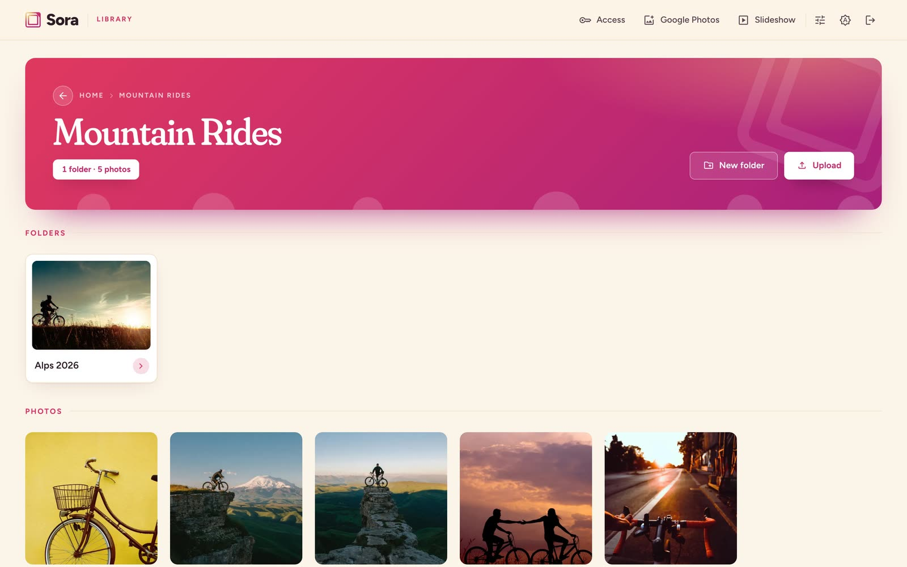<br><sub><b>Folders</b> — drop to upload, drag to move</sub></td>
  </tr>
  <tr>
    <td width="50%">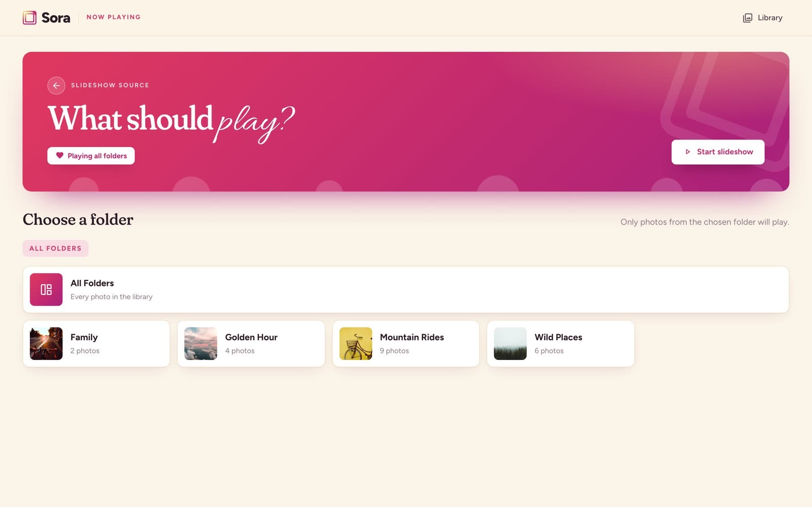<br><sub><b>Now playing</b> — choose a folder for the frame</sub></td>
    <td width="50%">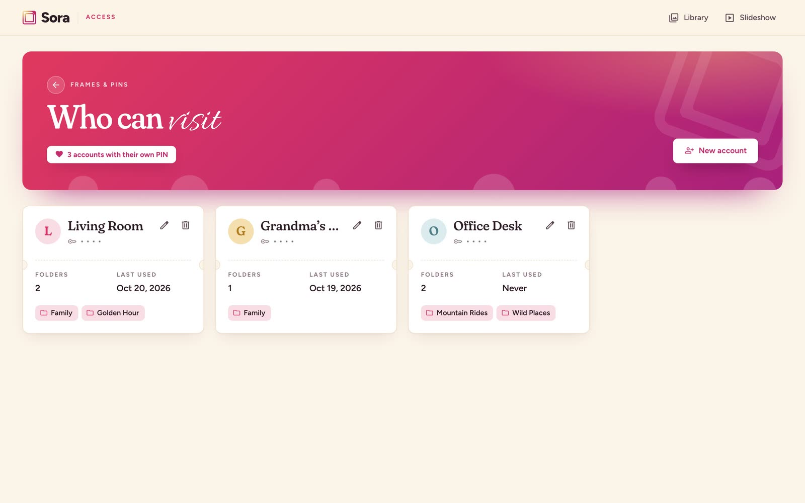<br><sub><b>Access</b> — a PIN per frame or person</sub></td>
  </tr>
  <tr>
    <td width="50%">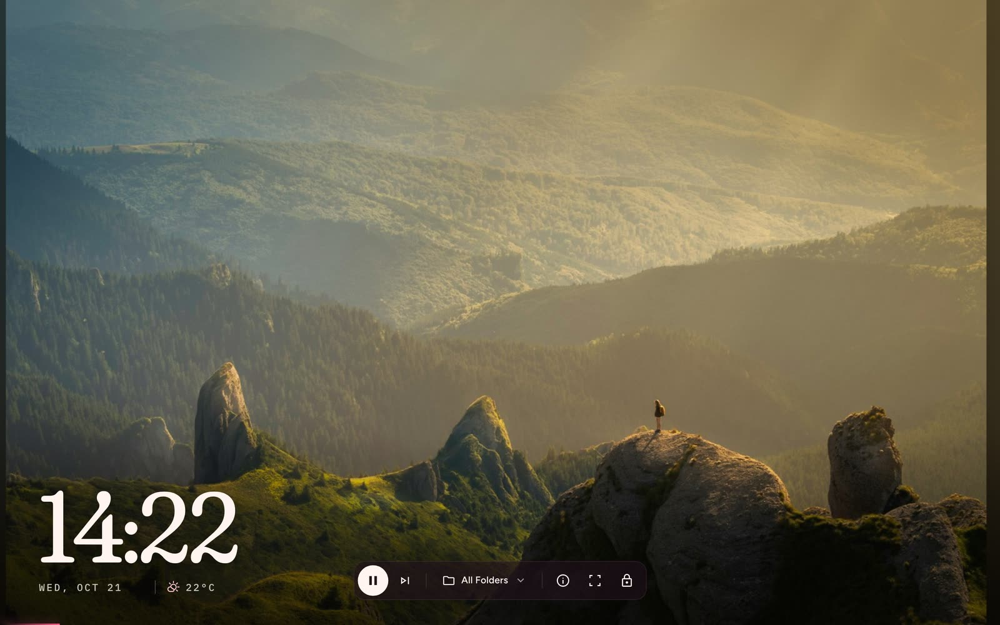<br><sub><b>Slideshow</b> — controls appear on hover</sub></td>
    <td width="50%">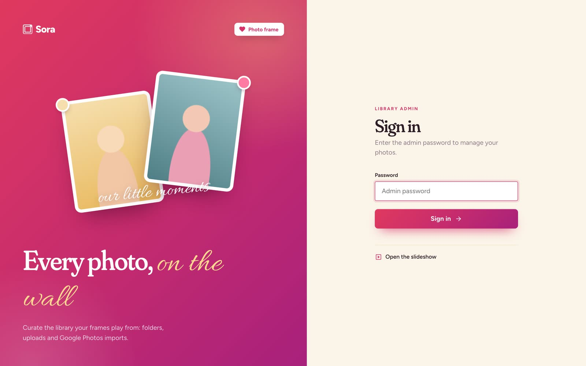<br><sub><b>Sign in</b> — admin password</sub></td>
  </tr>
  <tr>
    <td width="50%">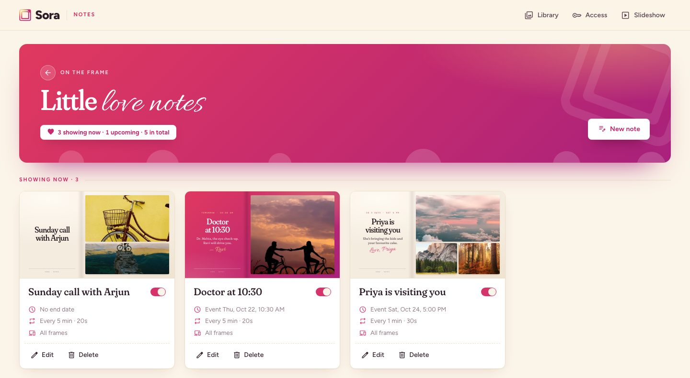<br><sub><b>Notes</b> — scheduled love notes and reminders</sub></td>
    <td width="50%">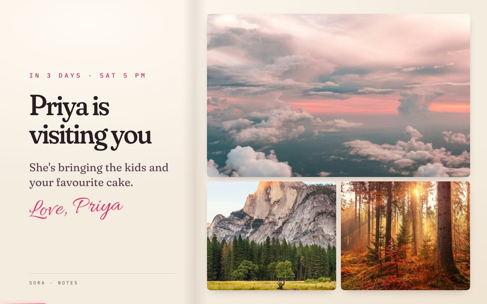<br><sub><b>On the frame</b> — a note between photos</sub></td>
  </tr>
</table>

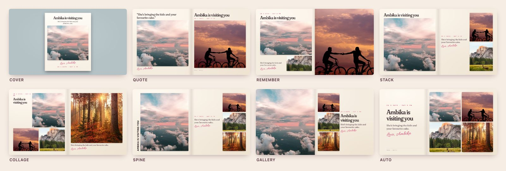

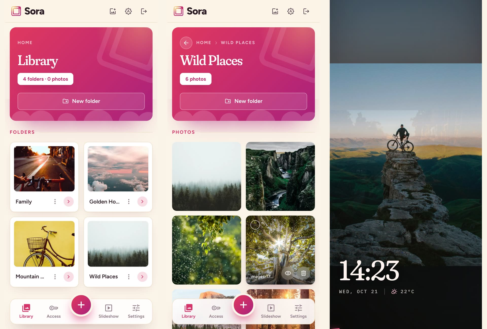

## Keyboard shortcuts

| Key | Slideshow |
|---|---|
| `Space` / `K` | Play or pause |
| `→` / `N` | Next photo |
| `F` | Fullscreen |
| `I` | Photo info |
| `Esc` | Leave fullscreen |

## Configuration

Settings live in `server/.env` (created on first `npm install`).

| Variable | Default | What it does |
|---|---|---|
| `ADMIN_PASSWORD` | — | Password for the library. **Change it.** |
| `PORT` | `3000` | Port the server listens on |
| `UPLOAD_DIR` | `uploads` | Where photos are stored |
| `DEFAULT_SLIDESHOW_INTERVAL` | `15000` | Time per photo, in ms |
| `MAX_FILE_SIZE` | `10485760` | Upload limit, in bytes (10 MB) |
| `ENABLE_GOOGLE_PHOTOS` | `false` | Turn on Google Photos import |

Supported formats: JPEG, PNG, WebP and GIF.

## Development

```bash
npm run dev   # server with auto-reload
npm test      # API tests
```

Node.js + Express on the server, plain HTML, CSS and JavaScript in the browser. Photos are plain files in folders — no database.

## Support

[Report an issue](https://github.com/Sorbh/sora-digital-photo-frame/issues) · [Discussions](https://github.com/Sorbh/sora-digital-photo-frame/discussions)

Licensed under ISC.

<p align="center"><sub>Built with ❤️ by Claude Code — monitored &amp; prompted by Saurabh K. Sharma</sub></p>
